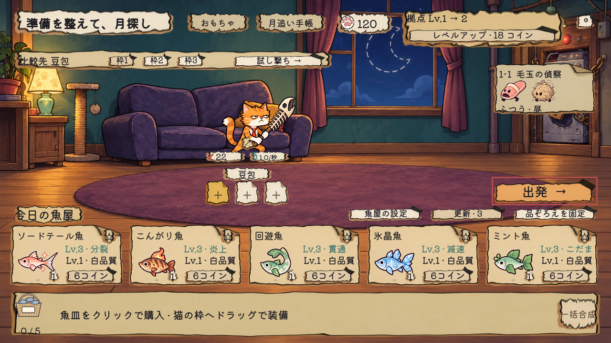
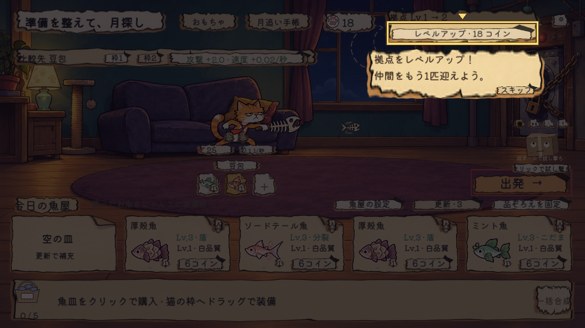

# にゃんこホーム — 猫と干し魚

洗濯機に盗まれた月を取り戻す、ねこたちのローグライト防衛ゲーム。

**Godot 4.7 / 2D / 日本語・简体中文**

猫を仲間にし、干し魚とおもちゃで攻撃を組み合わせて、キャットタワーを守ります。

[ブラウザー版で遊ぶ](https://kashin-ou.itch.io/cats-and-dried-fish) · [作品紹介](https://kashin.ink/works/nyanko-home)

> このリポジトリは v0.4.1 の編集用プロジェクトです。上記の公開ブラウザー版は v0.4.0 で、今回の変更はまだ含みません。



## 遊び方

1. 最初の猫と干し魚を選ぶ。
2. 拠点の魚屋で購入・更新・装備・合成を行う。拠点を強化すると、仲間枠と魚の収納数が増える。
3. 出発すると、猫はキャットタワーから自動で攻撃。拠点の耐久力を守りながら敵を倒す。
4. 発光した猫をクリックすると、その戦闘で一度だけ使える必殺技を発動。演出が終わるまで次の必殺技は待機する。
5. エリートやボスを倒し、おもちゃを選んで次のステージへ。

6種類の猫、5章・20ステージ、干し魚の成長とおもちゃの組み合わせを実装しています。プレイヤーキャラクターの自由移動はありません。買い物と装備の変更は戦闘の合間に行います。

## v0.4.1 の変更

- ハンマー猫「モチ」の攻撃範囲を 400 → 750 に調整。遠距離の仲間が先に倒し切ってしまう待ち時間を短縮しました。豆包の攻撃力・速度・射程は変更していません。
- 拠点強化と二択の仲間選びをガイドに追加。操作対象を明るくし、周囲を暗くする方式に変更しました。
- 最初の必殺技ガイド中は戦闘を一時停止。対象を押すか、ガイドをスキップすると再開します。
- 緊急おやつを廃止。以前のセーブで予約していた魚は、失わずに通常の装備へ利用できます。
- 拠点の強化ボタンを明確化。魚屋の補助設定をまとめ、戦闘下部は出撃中の猫の貢献と必殺技に整理しました。



## 起動

Godot **4.7 stable**（標準版、Compatibility レンダラー）で検証しています。外部プラグインや Blender は不要です。

```sh
git clone https://github.com/kash1n-tianxie/nyanko-home.git
cd nyanko-home
godot --editor --path .
```

エディターで `project.godot` を読み込み、F6 ではなく **F5** でプロジェクトを実行してください。初回は素材のインポートに時間がかかります。ゲーム内の設定から日本語／中国語を切り替えられます。

直接起動する場合：

```sh
godot --path .
```

F11 で全画面切替、Space で一時停止。ガイド中は「スキップ」または Esc で、その冒険のガイドを閉じられます。セーブと設定は Godot の `user://` に保存し、リポジトリには含めていません。

## 構成

| 場所 | 内容 |
| --- | --- |
| `scripts/main.gd` | 入力、描画、固定時間更新の接続 |
| `scripts/run_state.gd` | 所持品、購入、拠点、進行、セーブ |
| `scripts/combat.gd` | 射程、索敵、発射物、ダメージ |
| `scripts/catalog.gd` / `data/fish.json` | 猫・敵・ステージ・魚のデータ |
| `scripts/game_ui.gd` | ゲーム画面と拠点 UI |
| `scripts/run_guide*.gd` | ガイドの進行とスポットライト表示 |
| `scripts/camp_shop*.gd` | 魚屋のルールと表示 |
| `art/` / `audio/` / `fonts/` | 実行に必要な素材と第三者ライセンス |
| `localization/ja.json` | 日本語メッセージ |
| `tests/v041_verify.py` | 現バージョンの回帰検証 |

## 検証

Python 3 と PATH 上の `godot` が必要です。

```sh
python3 tests/v041_verify.py
# ウィンドウを表示して UI とガイドも描画検証する場合
python3 tests/v041_verify.py --native
```

結果は `outputs/v041/verification/` に出力します。検証には独立したデータ／専用の一時セーブを使用します。戦闘の数値比較は自動シミュレーションであり、人間によるプレイテストや一般的な勝率を示すものではありません。掲載画像には UI 検証用の編成・所持金を使った画面が含まれます。

この公開用工程には実行用素材を同梱しています。キャッシュ、プレイヤーのセーブ、個人用の制作記録、参考画像、古い 3D 実験、書き出し済みパッケージは含めていません。

## 素材と利用条件

独自コード・オリジナル素材について、汎用的な再利用ライセンスは現時点で設定していません。第三者素材には各フォルダー内のライセンスが適用されます。

- Kenney Interface Sounds：CC0。`audio/free-v040/KENNEY-LICENSE.txt` と `provenance.json` を参照。
- Kiwi Maru、霞鹜文楷、站酷快乐体：SIL Open Font License。`fonts/` 内に全文を同梱。
- 手描き調の画像には、制作補助に生成 AI を使用した素材を含みます。
